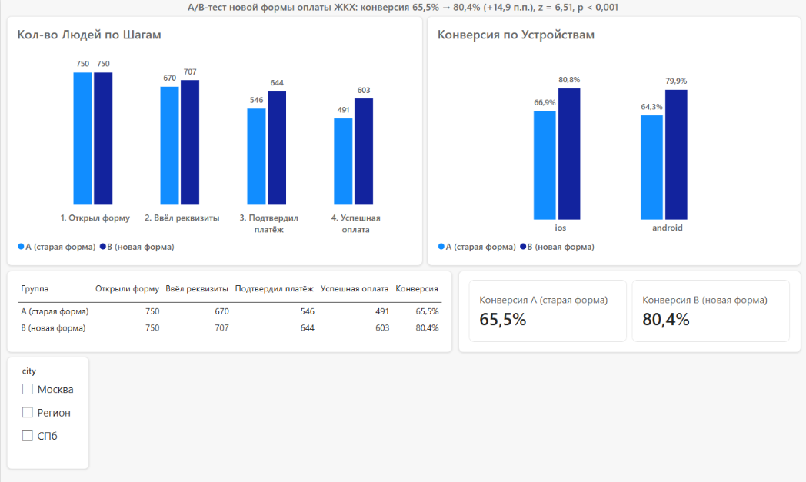

# Портфолио: продуктовая аналитика

Меня зовут Андрей. Ищу работу аналитика уровня middle. Ниже четыре учебных кейса: в них я считаю метрики, проверяю гипотезы, нахожу причины изменений и формулирую рекомендации для бизнеса.

**Инструменты:** Excel (формулы, сводные таблицы, проверки данных, диаграммы) · SQL (SQLite, DBeaver) · Python (pandas, scipy, scikit-learn, matplotlib) · Power BI (модель данных, меры DAX, дашборды) · статистика (z-тест для двух долей, доверительный интервал) · GitHub.

| Кейс | Тема | Инструменты |
|---|---|---|
| [1](#кейс-1-почему-упали-заказы-в-приложении-доставки) | Поиск причины падения заказов | Excel |
| [2](#кейс-2-ab-тест-новой-формы-оплаты-жкх) | A/B-тест формы оплаты | Excel, Power BI, статистика |
| [3](#кейс-3-ab-тест-формы-оплаты-жкх-на-sql) | Тот же A/B-тест на SQL | SQL (SQLite) |
| [4](#кейс-4-отток-подписчиков-стримингового-сервиса-python) | Отток подписчиков: статистика и модель | Python |

---

## Кейс 1. Почему упали заказы в приложении доставки

*Учебный кейс, данные условные.*

**Задача.** Главная метрика (число заказов) упала на 10% за неделю. Найти причину и предложить действие.

**Что сделал**
- Разложил воронку «открыли приложение → добавили в корзину → оформили заказ» по шагам и нашёл просевший шаг: открыли → корзина (30% → 27%).
- Разбил по платформам: на iOS без изменений, на Android 30% → 25%.
- Разбил Android по версиям приложения: версия 5.1 держит 30%, версия 5.2 даёт 18%.
- Оценил масштаб: около 300 потерянных корзин и около 100 потерянных заказов в неделю, что совпало с реальным падением (1 000 → 900).
- Добавил в файл контрольные проверки: суммы по версиям сходятся с общими, расчётные потери совпадают с фактом.

**Вывод.** Просадка связана с новой версией 5.2 на Android (−12 п.п., −40% к версии 5.1). Рекомендация: приостановить раскатку и откатить версию, считать проблему решённой, когда конверсия на Android вернётся к 30%.

**Файлы:** [расчёты (Excel)](case-1-orders-drop/calculation.xlsx) · [отчёт (Word)](case-1-orders-drop/report.docx)

---

## Кейс 2. A/B-тест новой формы оплаты ЖКХ

*Учебное задание, данные предоставлены в рамках курса.*

**Задача.** Проанализировать A/B-тест формы оплаты с автозаполнением реквизитов (1–30 апреля 2024) и решить, запускать ли её на всех пользователей.

**Что сделал**
- Очистил данные: из 2 660 платёжных записей удалил 3 аномальные (пользователь отсутствует в списке, аномальные номера платежей и интервалы между шагами, пользователь в чужой группе). Для поиска использовал формулы-проверки в Excel (поиск пользователя, сверка групп, сортировка по интервалам).
- Посчитал конверсию из шага 1 (открыл форму) в шаг 4 (успешная оплата) по людям: успех = хотя бы одна успешная оплата.
- Проверил значимость z-тестом для двух долей и построил доверительный интервал.
- Проверил, нет ли парадокса Симпсона, разбив результат по устройствам.
- Разобрал воронку по шагам: где новая форма выигрывает сильнее всего.
- Собрал дашборд в Power BI: связал таблицы пользователей и платежей (один ко многим), написал меры DAX (`DISTINCTCOUNT`, `CALCULATE`, `DIVIDE`, `SWITCH`), сделал воронку по группам, конверсию по устройствам, карточки с итогами и срез по городу.

**Результат**

| Группа | Открыли форму | Успешная оплата | Конверсия |
|---|---|---|---|
| A (старая форма) | 750 | 491 | 65,5% |
| B (новая форма) | 750 | 603 | 80,4% |

- Рост конверсии: **+14,9 п.п.** (+22,8% относительно A), 95% интервал от +10,5 до +19,4 п.п.
- z = 6,51, p < 0,001: разница не случайна.
- Новая форма лучше на обоих устройствах (Android 79,9% против 64,3%, iOS 80,8% против 66,9%).
- Сильнее всего разница на шаге «ввёл реквизиты → подтвердил платёж»: 81,5% → 91,1% (+9,6 п.п.).

**Рекомендация.** Запускать новую форму поэтапно, следя за ошибками оплаты, возвратами и временем платежа (этих метрик в данных нет, их нужно подключить до старта).

**Дашборд в Power BI**



**Файлы:** [расчёты (Excel)](case-2-ab-payment-form/calculation.xlsx) · [отчёт (Word)](case-2-ab-payment-form/report.docx) · [дашборд (папка с PNG и файлом Power BI)](case-2-ab-payment-form/dashboard/)

---

## Кейс 3. A/B-тест формы оплаты ЖКХ на SQL

*Тот же кейс, что и кейс 2, но все расчёты сделаны SQL-запросами. Цифры совпали с Excel и Power BI.*

**Что сделал**
- Нашёл три аномальные записи в сырых данных запросом (`LEFT JOIN`, `CASE`, проверка интервала между шагами через `strftime`).
- Проверил очищенные данные: нет платежей без пользователя, дублей, несовпадения групп (`UNION ALL`).
- Посчитал воронку, конверсию по группам и устройствам, конверсию между соседними шагами (`CTE`, `COUNT(DISTINCT ...)`).
- Проверил значимость z-тестом для двух долей прямо в SQL.

**Результат:** конверсия 65,5% → 80,4% (+14,9 п.п.), z = 6,51, p < 0,001, как и в Excel.

**Файлы:** [запросы с комментариями (queries.sql)](case-3-ab-sql/queries.sql) · [описание кейса](case-3-ab-sql/)

---

## Кейс 4. Отток подписчиков стримингового сервиса (Python)

*Синтетический датасет Kaggle (5 000 клиентов). Кейс про метод и выводы для бизнеса, а не про закономерности реального рынка.*

**Задача.** Понять, какие клиенты уходят, насколько надёжно эти связи подтверждаются статистикой, и найти клиентов в зоне риска.

**Что сделал**
- Проверил качество данных и нашёл расчётный столбец (`watch_hours / (last_login_days + 1)`) с нереальными значениями, удалил его.
- Посчитал отток по сегментам с доверительными интервалами и проверил значимость (хи-квадрат, тест Манна-Уитни).
- Нашёл скачок оттока после 30 дней без входа и построил график.
- Обучил логистическую регрессию, интерпретировал коэффициенты через отношение шансов.
- Перевёл отток в деньги и выделил активных клиентов с высоким риском.

**Результат**
- Общий отток 50,3%. Выше у тарифа Basic (61,8% против 44–45%), у оплаты криптой и подарочной картой (58–60% против 44%), у клиентов с 1–3 профилями (58% против 38–41%). Регион, устройство, пол, жанр и возраст отток не объясняют.
- После 30 дней без входа отток растёт с 38% до 68–77%.
- Модель: ROC-AUC 0,961, precision 0,88, recall 0,89.
- Ушедшие клиенты платили $33 010 из $68 417 месячной выручки (48%). В зоне риска 275 активных клиентов, они платят около $3 807 в месяц.

**Рекомендация.** Триггерное предложение на 25-й день неактивности для групп риска и проверка эффекта A/B-тестом.

**Файлы:** [ноутбук и описание](case-4-churn-python/) · [churn_analysis.ipynb](case-4-churn-python/churn_analysis.ipynb)

---

## Навыки и где они показаны

| Навык | Где виден |
|---|---|
| Продуктовые метрики: воронка, конверсия, п.п. и относительный рост | кейсы 1, 2, 3 |
| Диагностика падения метрики: разбивка по платформам и версиям, оценка потерь | кейс 1 |
| A/B-тест: z-тест, доверительный интервал, проверка парадокса Симпсона | кейсы 2, 3 |
| Очистка данных, поиск аномалий и дублей, контрольные сверки | кейсы 1, 2, 3 |
| Excel: формулы, сводные таблицы, проверки, диаграммы | кейсы 1, 2 |
| SQL: JOIN, CASE, CTE, агрегаты, UNION ALL, работа с датами | кейс 3 |
| Power BI: модель данных, меры DAX, дашборд со срезами | кейс 2 |
| Python: pandas, проверка и очистка данных, графики (matplotlib) | кейс 4 |
| Статистика: хи-квадрат, тест Манна-Уитни, доверительные интервалы | кейсы 2, 4 |
| Модель оттока: логистическая регрессия, ROC-AUC, интерпретация коэффициентов | кейс 4 |
| Перевод метрик в деньги, сегментация клиентов по риску | кейс 4 |
| Выводы и рекомендации для бизнеса, отчёты | кейсы 1, 2 |
| GitHub: оформление проектов, README | этот репозиторий |


---

## Структура репозитория

```
├── README.md
├── case-1-orders-drop/
│   ├── calculation.xlsx
│   └── report.docx
├── case-2-ab-payment-form/
│   ├── calculation.xlsx
│   ├── report.docx
│   └── dashboard/
│       ├── dashboard.png
│       └── dashboard.pbix
├── case-3-ab-sql/
│   ├── queries.sql
│   └── README.md
└── case-4-churn-python/
    ├── churn_analysis.ipynb
    └── README.md
```

